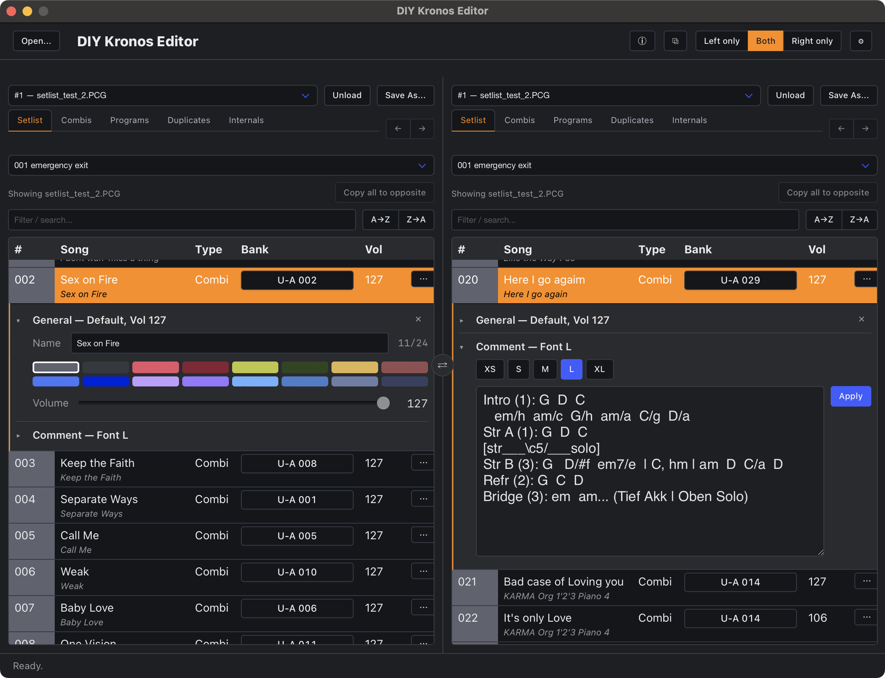

# DIY Kronos Editor

[](https://github.com/jens-goes-mad/DIY-KORG-KRONOS-EDITOR.public/actions/workflows/native-build.yml)
[](https://ko-fi.com/diykorgkronoseditor)

A cross-platform, cross-architecture editor for Korg Kronos `.PCG`/`.SNG`
files.



## Download

Prebuilt binaries, one per platform (unsigned -- see [Build](#build) below if your OS blocks it and you'd rather not build from source):

- [macOS (Apple Silicon)](https://github.com/jens-goes-mad/DIY-KORG-KRONOS-EDITOR.public/releases/latest/download/kronos_editor-macos-arm64.zip)
- [macOS (Intel)](https://github.com/jens-goes-mad/DIY-KORG-KRONOS-EDITOR.public/releases/latest/download/kronos_editor-macos-x86_64.zip)
- [Linux (x86_64)](https://github.com/jens-goes-mad/DIY-KORG-KRONOS-EDITOR.public/releases/latest/download/kronos_editor-linux-x86_64.zip)
- [Windows (x86_64)](https://github.com/jens-goes-mad/DIY-KORG-KRONOS-EDITOR.public/releases/latest/download/kronos_editor-windows-x86_64.exe)

These always point at the newest [release](https://github.com/jens-goes-mad/DIY-KORG-KRONOS-EDITOR.public/releases) --
built and attached automatically by `.github/workflows/native-build.yml` on every
version tag push (`git tag vX.Y.Z && git push --tags`). The macOS/Linux downloads are
`.zip` (unzip it, then run the `kronos_editor` inside -- a raw executable loses its
"you're allowed to run this" bit over a plain HTTP download, which a zip preserves).

**macOS specifically**: since the app isn't signed/notarized, the first launch needs
**right-click -> Open** (not a plain double-click) so Gatekeeper offers an "Open Anyway"
choice instead of just refusing -- only needed once per download.

## Why this exists

Korg never published the layout of the Kronos's `.PCG`/`.SNG` backup files, so
managing a real library -- years of duplicate Programs, Set Lists scattered
across gig backups, no way to compare two backups side by side -- meant doing it
by hand on the unit's own screen. This project reverse-engineers the format byte
by byte, verified against real backup files (never guessed), and builds a
cross-platform editor on top of it.

The full story, user guide, and format reference live on
**[the docs site](https://jens-goes-mad.github.io/DIY-KORG-KRONOS-EDITOR.public/overview)**:

- [Overview](https://jens-goes-mad.github.io/DIY-KORG-KRONOS-EDITOR.public/overview) -- what it does and why
- [User Guide](https://jens-goes-mad.github.io/DIY-KORG-KRONOS-EDITOR.public/guide/) -- every pane and button, with screenshots
- [The file format](https://jens-goes-mad.github.io/DIY-KORG-KRONOS-EDITOR.public/format/) -- the reverse-engineered `.PCG`/`.SNG` layout
- [App architecture & components](https://jens-goes-mad.github.io/DIY-KORG-KRONOS-EDITOR.public/components/) -- how to contribute without building the native app

**Stack**: C++ (CMake) with [CHOC](https://github.com/Tracktion/choc) for the
native window/WebView, plain HTML/JS/CSS (no bundler), vendored
[Bulma](https://bulma.io) and [Tabulator](https://tabulator.info), `ctest` plus
headless `node` tests for the byte-level code, and GitHub Actions CI for macOS
(arm64+Intel), Linux, and Windows. [`STATE.md`](STATE.md) tracks what's built,
what's verified, and the open questions -- the place to look for where help is
most useful. Ideas, bug reports, and pull requests are all welcome.

## What it does

Open one or more `.PCG` backups; each becomes a **dataset**. The two panes each
pick a dataset and a category independently -- point both at the same backup
to rearrange it, or at two different backups to compare and copy between them.

- **[Setlist](https://jens-goes-mad.github.io/DIY-KORG-KRONOS-EDITOR.public/guide/setlist/)** -- browse, filter and drag-and-drop the 128
  slots of a Set List; edit a slot's Color, Volume, Comment and Font size; copy,
  reset or compact a whole Set List, and print it as a stage leadsheet.
- **[Programs](https://jens-goes-mad.github.io/DIY-KORG-KRONOS-EDITOR.public/guide/prog/) / [Combis](https://jens-goes-mad.github.io/DIY-KORG-KRONOS-EDITOR.public/guide/combi/)** -- browse every
  Program and Combi by bank, see which Set List slots use them, find duplicates,
  and reset a slot to its Init Program.
- **[Cross-Dataset Tools](https://jens-goes-mad.github.io/DIY-KORG-KRONOS-EDITOR.public/guide/cross-dataset/)** -- duplicates and
  differences between two backups, and a slot-by-slot Program/Combi compare.
- **Internals** -- which chunks and banks a backup actually contains.

The complete `.PCG`/`.SNG` layout this is built on is documented in
[`docs/content/format/index.md`](docs/content/format/index.md)
(also on [the docs site](https://jens-goes-mad.github.io/DIY-KORG-KRONOS-EDITOR.public/format/)).

## Build

Builds on macOS (arm64 + Intel), Linux, and Windows -- verified via CI
([`.github/workflows/native-build.yml`](.github/workflows/native-build.yml)),
one CMake project, no per-platform source trees (CHOC maps to WebKit/
WebKit2GTK/WebView2 depending on the OS). Full requirements and
platform-specific notes: **[docs/content/building](docs/content/building/index.md)**
(also live at [the project site](https://jens-goes-mad.github.io/DIY-KORG-KRONOS-EDITOR.public/building/)).

```sh
cmake -B build -DCMAKE_BUILD_TYPE=Debug
cmake --build build
./build/kronos_editor
```

Files can be given on the command line and are opened as datasets at startup -- the first
lands in the left pane, the second in the right, any more are available from the panes'
dataset selectors:

```sh
./build/kronos_editor ../KRONOS-SOUNDS/INIT.PCG ../KRONOS-SOUNDS/K1_20260418.PCG
```

Debug builds read `frontend/` live off disk (edit-reload friendly). Release
builds (`-DCMAKE_BUILD_TYPE=Release`, or `-DEDITOR_EMBED_RESOURCES=ON`)
embed `frontend/` and `resources/` into the binary via `tools/embed_resources.py`, and on
macOS produce a real `build/kronos_editor.app` bundle instead of a bare executable (see
[docs/content/building](docs/content/building/index.md) for exactly where each platform's
build output ends up).

This repo has one optional, private companion submodule
(`private/diy-korg-kronos-editor`, see `STATE.md`) for functionality out of scope for
this public project -- it's never required: a plain `git clone` (no
`--recurse-submodules`) builds and runs `kronos_editor` exactly the same, just without
whatever that submodule adds. If you have access to it, `git submodule update --init`
pulls it in.

**Don't want to build locally?** See [Download](#download) above for prebuilt binaries.
For a one-off build of an arbitrary commit (not a tagged release), the native-build
workflow can also be triggered manually (`workflow_dispatch`) from the Actions tab --
[Actions -> Build Kronos Editor (native) -> Run
workflow](https://github.com/jens-goes-mad/DIY-KORG-KRONOS-EDITOR.public/actions/workflows/native-build.yml).
Once the run finishes, its summary page lists 4 downloadable artifacts, one per
platform: `kronos-editor-macos-arm64`, `kronos-editor-macos-x86_64`,
`kronos-editor-linux-x86_64`, `kronos-editor-windows-x86_64` -- unlike the tagged
Download links above, these need a GitHub login and expire after 90 days.

## Testing

```sh
# C++: scoped to just the format-parsing code (no CHOC/WebView build needed)
cmake --build build --target pcg_file_test
ctest --test-dir build -R pcg_file_test

# Frontend: headless, per-component
node frontend/components/kronos/setlist-editor-comment-and-font.test.js
```

See **[docs/content/components](docs/content/components/index.md)**'s "Committed,
headless test suites" section for how these fit alongside each component's
`.test.html` browser harness.

## Architecture direction

Both the frontend and backend are moving toward small, focused
decoder/encoder units instead of one big eager parse -- see
**[docs/content/components](docs/content/components/index.md)** (also
live at [the project site](https://jens-goes-mad.github.io/DIY-KORG-KRONOS-EDITOR.public/components/))
for the rationale, and `STATE.md`'s "ARCHITECTURE: DECODER/ENCODER
REFACTOR" section for the current decision and where it's headed next
(Program decoder first, then Combi, then Set List slot).

## Layout

```
docs/README.md                -- short pointer to docs/content/format/index.md below
docs/content/format/index.md  -- the full file-format internals reference (also the Hugo docs site)
docs/content/                 -- the public Hugo/GitHub Pages docs site
src/
  kronos/PcgFile.{h,cpp}     -- the file-format parser (implements docs/content/format/index.md)
  bridge/EditorBridge.{h,cpp} -- native functions exposed to the web UI
  platform/NativeFileDialog.{h,cpp} -- native Open/Save dialog (macOS; Windows/Linux stubbed)
  main.cpp                   -- CHOC window/webview wiring
frontend/
  index.html, app.js, style.css   -- topbar (global Open button) + shared wiring
  datasets.js                  -- shared dataset registry (open files, decoupled from pane) -- see Datasets above
  pane.js                      -- pane shell (dataset selector + Setlist/Programs/Combis/Duplicates/Internals category nav) + Setlist UI
  library.js                   -- Programs/Combis/Duplicates category content, embedded per-pane (not a separate tab)
  internals.js                 -- Internals category content: which chunks/banks a dataset contains, embedded per-pane
  mock_bridge.js              -- fake in-memory backend for plain-browser dev (no native build needed)
  vendor/bulma.min.css         -- vendored Bulma (CSS only, no JS/build-step dependency) -- see docs/content/components
  vendor/tabulator/            -- vendored Tabulator 6.5.3 (MIT) -- ONLY the Cross Dataset analysis sidebar's tables use it
  components/kronos/          -- standalone, byte-level-tested UI pieces (see Architecture direction above)
third_party/choc/            -- vendored from DIY-MIDI-METRONOME/EDITOR
```

## Support

DIY Kronos Editor is an after-hours project, free for any noncommercial use. If it saved
you an evening of scrolling through Set Lists on the Kronos's own screen, you can buy me
a coffee on [Ko-fi](https://ko-fi.com/diykorgkronoseditor) -- it keeps the late-night
byte hunting going. Thank you!

## License

Source-available under the [PolyForm Noncommercial License 1.0.0](LICENSE) -- free to use,
modify, and share for any noncommercial purpose (personal, research, educational, hobby,
nonprofit). Not OSI "open source" in the strict sense: commercial use needs a separate
agreement first -- see [`LICENSE`](LICENSE) for how to ask.